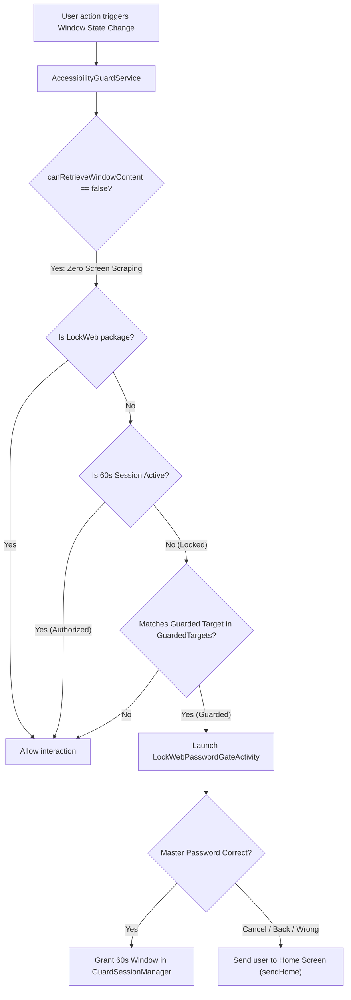

# LockWeb Anti-Tamper Guide

This guide explains the inner workings of LockWeb's self-protection engine, how the **Anti-Tamper Guard** prevents impulsive bypasses, what it can and cannot protect against, and the future upgrade path (Device Owner mode).

---

## 1. The Threat Model: The User Is the Adversary

Most website blockers fail because they assume the user is trying to cooperate. When cravings, distractions, or compulsive habits kick in, the user actively tries to disable the blocker:
- Opening Android Settings to **Force Stop** or **Clear Data**.
- Disconnecting or toggling off the **VPN**.
- Turning on **Private DNS (DoT)** in Android to bypass the local VPN filter.
- Enabling **Secure DNS (DoH)** in Google Chrome.
- Deactivating **Device Administrator** to uninstall the app.
- Attempting to uninstall directly via the **Google Play Store**.

LockWeb is built on the core principle: **You cannot disable or bypass protection without entering the Master Password.**

---

## 2. Architecture of the Anti-Tamper Guard



### Key Components:
1. **`AccessibilityGuardService`**:
   - Registered with Android's Accessibility Framework.
   - Listens exclusively for `TYPE_WINDOW_STATE_CHANGED`.
   - `canRetrieveWindowContent` is explicitly set to `false` for complete privacy.
2. **`GuardedTargets`**:
   - Comprehensive registry of package and class regexes covering AOSP Android Settings, OEM skins (Samsung One UI, Xiaomi MIUI Security Center), Google Chrome Secure DNS, and Google Play Store package details.
3. **`LockWebPasswordGateActivity`**:
   - Rendered with `FLAG_SECURE` (cannot be screenshotted or recorded).
   - Rate-limited with exponential backoff (persisted across process death via `FileRateLimitStore`).
   - Pressing Back or Cancel immediately invokes `AccessibilityGuardService.sendHome()`, returning the user to their phone launcher.
4. **`GuardSessionManager`**:
   - Manages a temporary 60-second administrative session upon verified password authentication.
   - Automatically expires, ensuring settings cannot remain permanently unlocked.

---

## 3. What the Anti-Tamper Guard Protects

| Attack Vector | Guarded Target / Mitigation | Result |
|---|---|---|
| **Force Stop** in App Info | `com.android.settings.*InstalledAppDetails*`, `*AppInfo*`, `*SpaActivity*` | Intercepted with Password Gate |
| **Clear Data / Clear Storage** | `com.android.settings.*ManageApplications*` | Intercepted with Password Gate |
| **Deactivate Device Admin** | `com.android.settings.*DeviceAdmin*` | Intercepted with Password Gate |
| **Disconnect VPN** in Settings | `com.android.settings.*VpnSettings*`, `*vpn2*` | Intercepted with Password Gate |
| **Toggle Private DNS (DoT)** | `com.android.settings.*PrivateDns*` | Intercepted with Password Gate |
| **Toggle Chrome Secure DNS (DoH)**| `com.android.chrome/org.chromium.chrome.browser.privacy.settings.*` | Intercepted with Password Gate |
| **Play Store Uninstall** | `com.android.vending/com.google.android.finsky.activities.AppDetailsActivity` | Intercepted with Password Gate |
| **Disable Accessibility Guard** | Intercepts navigation to LockWeb inside Accessibility Settings | Intercepted with Password Gate |
| **OEM Specific App Managers** | `com.samsung.android.settings`, `com.miui.securitycenter` | Intercepted with Password Gate |

---

## 4. What It CANNOT Protect Against (System Boundaries)

Operating within standard non-root Android user-space imposes physical and OS-level boundaries:

### 1. Safe Mode Boot
- **The Vector:** Powering off the phone and booting into Android "Safe Mode" disables all 3rd-party apps and accessibility services temporarily.
- **Why Guard Cannot Stop It:** Android firmware executes Safe Mode before any third-party app code runs.
- **Mitigation:** Requires deliberate physical key combinations during reboot. When booted normally again, LockWeb's `BootReceiver` restarts protection immediately.

### 2. ADB Debugging (USB Computer Access)
- **The Vector:** Connecting the phone to a PC with USB Debugging enabled and executing `adb uninstall com.lockweb.app`.
- **Why Guard Cannot Stop It:** ADB communicates directly with Android's `pm` daemon over USB, bypassing the graphical window manager.
- **Mitigation:** Turn off **Developer Options** and **USB Debugging** on your phone.

### 3. Physical Factory Reset
- **The Vector:** Booting into recovery mode and selecting "Wipe data / Factory reset".
- **Why Guard Cannot Stop It:** Recovery mode operates outside the Android OS.

---

## 5. Future Upgrade Path: Device Owner Mode (V2)

In an upcoming release (V2), LockWeb can be provisioned as a **Device Owner** (Enterprise Management mode) via a one-time ADB setup command on a freshly factory-reset or clean device:

```bash
adb shell dpm set-device-owner com.lockweb.app/.admin.LockWebDeviceAdminReceiver
```

### What Device Owner Mode Enables:
1. **`DISALLOW_UNINSTALL_APPS`**: Android completely forbids uninstallation, even via ADB.
2. **`DISALLOW_SAFE_BOOT`**: Android disables the Safe Mode key combination entirely.
3. **`setAlwaysOnVpnPackage`**: Locks the VPN at the OS level so it cannot be revoked under any circumstance.
4. **`DISALLOW_CONFIG_VPN`**: Removes the VPN configuration menu from Android Settings.
