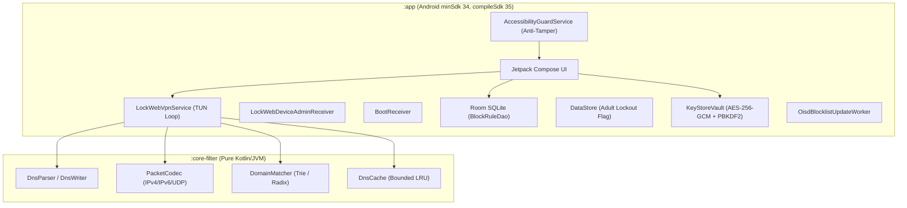

# LockWeb — Architecture & System Design

## 1. Toolchain & Dependency Matrix

| Component | Selected Version | Rationale & Compatibility |
|---|---|---|
| **JDK** | 17 (Temurin / OpenJDK 17) | Required minimum for Android Gradle Plugin 8.x. Fully supported by GitHub Actions `actions/setup-java`. |
| **Gradle** | 8.9 | Recommended and required minimum Gradle version for AGP 8.7.3. Stable release with full Kotlin DSL support. |
| **Android Gradle Plugin (AGP)** | 8.7.3 | Current stable release supporting `compileSdk = 35` and `minSdk = 34`. Fully compatible with JDK 17 and Gradle 8.9. |
| **Kotlin** | 2.0.21 | Stable Kotlin 2.0 compiler release. Bundles the new Compose Compiler Gradle plugin natively. |
| **Kotlin Compose Plugin** | 2.0.21 (`org.jetbrains.kotlin.plugin.compose`) | Since Kotlin 2.0.0, the Jetpack Compose compiler is integrated directly into the Kotlin compiler release train. |
| **KSP** | 2.0.21-1.0.28 | Matching Kotlin Symbol Processing plugin for Kotlin 2.0.21, required for Room annotation processing. |
| **Compose BOM** | 2024.10.01 | Stable Bill of Materials for Jetpack Compose (`ui`, `material3`, `runtime`). |
| **Room** | 2.6.1 | Stable SQLite object mapping library with coroutines and KSP support. |
| **DataStore Preferences** | 1.1.1 | Modern replacement for SharedPreferences with coroutine Flow integration. |
| **WorkManager** | 2.9.1 | Stable Android background task scheduler for periodic weekly blocklist updates. |
| **Coroutines** | 1.9.0 | Stable Kotlin asynchronous programming library matching Kotlin 2.0+. |
| **Core KTX** | 1.15.0 | Android KTX extensions for modern Android APIs. |
| **Activity Compose** | 1.9.3 | Stable integration between Android ComponentActivity and Jetpack Compose. |

---

## 2. Module Boundaries

1. **`:core-filter`**
   - **Language:** Pure Kotlin / JVM.
   - **Dependencies:** Standard library and JUnit only. Zero Android framework dependencies.
   - **Responsibility:** URL parsing, domain normalization (IDNA/RFC 1035), label-boundary domain matching, IPv4/IPv6/UDP packet codec with RFC checksums, DNS wire protocol parsing/building (NXDOMAIN), and blocklist file ingestion.
   - **CI Benefit:** Fast, headless JVM unit test execution without Android emulators.

2. **`:app`**
   - **Language:** Kotlin / Android (minSdk 34, compileSdk 35).
   - **Dependencies:** Android Jetpack (Compose, Room, DataStore, WorkManager), `:core-filter`.
   - **Responsibility:** Android UI (Jetpack Compose), `VpnService` TUN interface loop, `AccessibilityGuardService` anti-tamper monitor, `DeviceAdminReceiver`, hardware-backed Keystore security, and persistent storage.

---

## 3. Storage & Security Architecture

1. **User Rules (Room SQLite):**
   - Stored in `AppDatabase` via `BlockRuleDao` (`block_rules` table).
   - Rules include `domain`, `ruleMode` (`SUBDOMAINS` or `EXACT`), and `createdAt` timestamp.
   - Queries are reactive via coroutine `Flow<List<BlockRuleEntity>>`.
2. **Permanent Adult Filter (DataStore Preferences):**
   - `is_adult_filter_permanently_enabled` boolean flag stored in `lockweb_settings.preferences_pb`.
   - Once set to `true`, the `enableAdultBlocklistPermanently()` method writes to disk with no reverse mutation API.
3. **Hardware KeyStore & PBKDF2 Vault:**
   - Password hash derived using `PBKDF2WithHmacSHA256` with 600,000 iterations.
   - Salt and hashed verification tokens are encrypted with an AES-256-GCM key generated in the hardware-backed `AndroidKeyStore`.
   - Master password strings are held only as ephemeral `CharArray` primitives and zeroed immediately after use.
4. **Rate Limiting Engine:**
   - `RateLimiter` enforces exponential delays (5 attempts → 30s → 60s → 300s → 900s).
   - State is backed by `FileRateLimitStore` on local storage to maintain lockout state across process kills, recents-clearing, and reboots.

---

## 4. Signing Configuration & Fixed Debug Keystore

In continuous integration environments (such as GitHub Actions runners), generating a transient debug keystore causes `INSTALL_FAILED_UPDATE_INCOMPATIBLE` because the RSA key changes on every run. 

Committing a permanent debug keystore (`app/debug.keystore`) ensures:
1. Every CI build shares the exact same cryptographic signature.
2. Updates install seamlessly on test devices without requiring an uninstallation (which is intentionally blocked by Device Admin).
