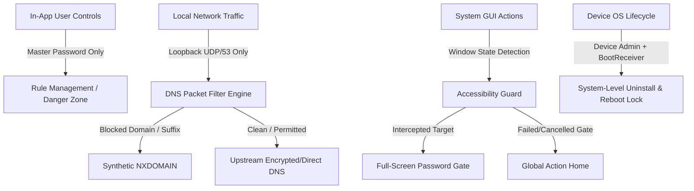

# LockWeb Threat Model

This document outlines the security architecture and threat analysis for LockWeb. In a self-control system, the user is considered the **primary adversary**.

---

## 1. Adversary Profile & Motivation

* **Adversary:** The device owner operating in an impulsive, compulsive, or craving state.
* **Objective:** Bypass website blocks, disable the adult content filter, or uninstall LockWeb without entering the master password.
* **Capabilities:** Full physical possession of the device, screen lock credentials, and normal user-level OS privileges.
* **Constraint:** The adversary does not wish to reset their entire life (e.g. factory reset their phone with data loss) or carry around a computer with ADB at all times.

---

## 2. Attack Vectors & Mitigations Matrix

| # | Attack Vector | Mitigated? | Mechanism / Countermeasure |
|---|---|---|---|
| **1** | **Direct Launcher Uninstall** | ✅ Yes | Android Device Administrator active (`LockWebDeviceAdminReceiver`). OS grays out "Uninstall". |
| **2** | **App Info "Force Stop"** | ✅ Yes | `AccessibilityGuardService` intercepts Settings `AppInfoDashboardFragment` / `SpaActivity` and launches Password Gate. |
| **3** | **App Info "Clear Storage"** | ✅ Yes | `AccessibilityGuardService` intercepts storage management before buttons can be pressed. |
| **4** | **Deactivating Device Admin** | ✅ Yes | Intercepted in Settings. `onDisableRequested()` also warns of compromised protection. |
| **5** | **Disabling VPN in Settings** | ✅ Yes | Intercepted by Guard. Supported by Android "Always-on VPN" + "Block connections without VPN" (Lockdown). |
| **6** | **Disabling Accessibility Service** | ✅ Yes | Guard intercepts `AccessibilitySettings` navigation targeting LockWeb. |
| **7** | **Android Private DNS (DoT) Bypass** | ✅ Yes | DNS queries over TLS bypass local UDP/53 VPN. LockWeb detects Private DNS strict mode, alerts the user, and guards the Private DNS dialog from being enabled. |
| **8** | **Chrome Secure DNS (DoH) Bypass** | ✅ Yes | Guard intercepts Google Chrome's `SecureDnsSettings` activity. LockWeb blocks known DoH bootstrap resolvers locally. |
| **9** | **Play Store Uninstall** | ✅ Yes | Guard intercepts `com.android.vending.activities.AppDetailsActivity`. |
| **10** | **Process Killing / OS Task Clear** | ✅ Yes | Rules are persisted in Room SQLite. VPN foreground service runs with `specialUse` priority and auto-restarts on boot (`BootReceiver`). |
| **11** | **Brute-Force Password Guessing** | ✅ Yes | `RateLimiter` enforces exponential lockout delays (5 attempts → 30s → 60s → 300s → 900s). Lockout timestamps are stored in `FileRateLimitStore` on disk and survive process death and reboot. |
| **12** | **Memory Inspection / Screenshots** | ✅ Yes | `FLAG_SECURE` prevents screenshots, screen recording, and system task snapshots. Passwords stored in `CharArray` and zeroed out after PBKDF2 hashing. |
| **13** | **Disabling Adult Content Filter** | ✅ Yes | Irreversible DataStore flag (`isAdultBlocklistPermanentlyEnabled`). No code path or password challenge allows resetting this flag once set. |
| **14** | **Rebooting the Phone** | ✅ Yes | `BootReceiver` listens for `BOOT_COMPLETED` and immediately restarts VPN and watchdog checks. |
| **15** | **Safe Mode Reboot** | ⚠️ Partial | Safe Mode temporarily suppresses 3rd-party accessibility services. Protection resumes immediately upon normal reboot. Total elimination requires V2 Device Owner. |
| **16** | **ADB Command-Line (`adb uninstall`)** | ⚠️ Partial | Accessible only via USB debugging on a computer. User is advised to turn off Developer Options. Total elimination requires V2 Device Owner. |
| **17** | **Hardware Factory Reset** | ❌ No | Erases all device contents and firmware state. Unavoidable on unmanaged consumer Android hardware. |

---

## 3. Defense-in-Depth Layering

---

## 4. Cryptographic Guarantees

* **Hash Derivation:** `PBKDF2WithHmacSHA256` with 600,000 iterations and a 128-bit cryptographically secure salt.
* **Encryption at Rest:** AES-256-GCM via `AndroidKeyStore`.
* **Zero Plaintext Storage:** Neither the master password nor user-visited websites are ever stored on disk or emitted in logcat.
